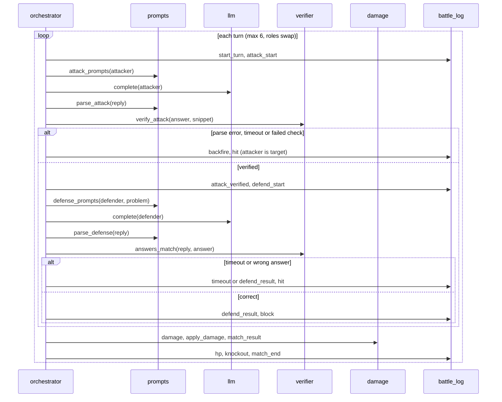

# Flow

Task 7 adds the CLI at the top of this flow; task 8 adds `stats` reading the `MatchRecord`s.

## Modules

- `models`: dataclasses (`Fighter`, `Attack`, `TurnResult`, `MatchRecord`, `MatchResult`).
- `damage`: pure rule functions and the Phase 0 constants (HP, base damage, max turns).
- `verifier`: SymPy answer equality and the snippet runner (subprocess, timeout, temp dir).
- `battle_log`: per-turn event list with `t` in ms, JSON writer.
- `config`: loads `config/fighters.toml` into settings, providers and fighters.
- `llm`: OpenAI-compatible client per provider, 429 backoff, delay between calls.
- `prompts`: attacker and defender prompts and tag parsing of the replies.
- `orchestrator`: `play_turn` and `run_match`, the only module that sequences a match.
