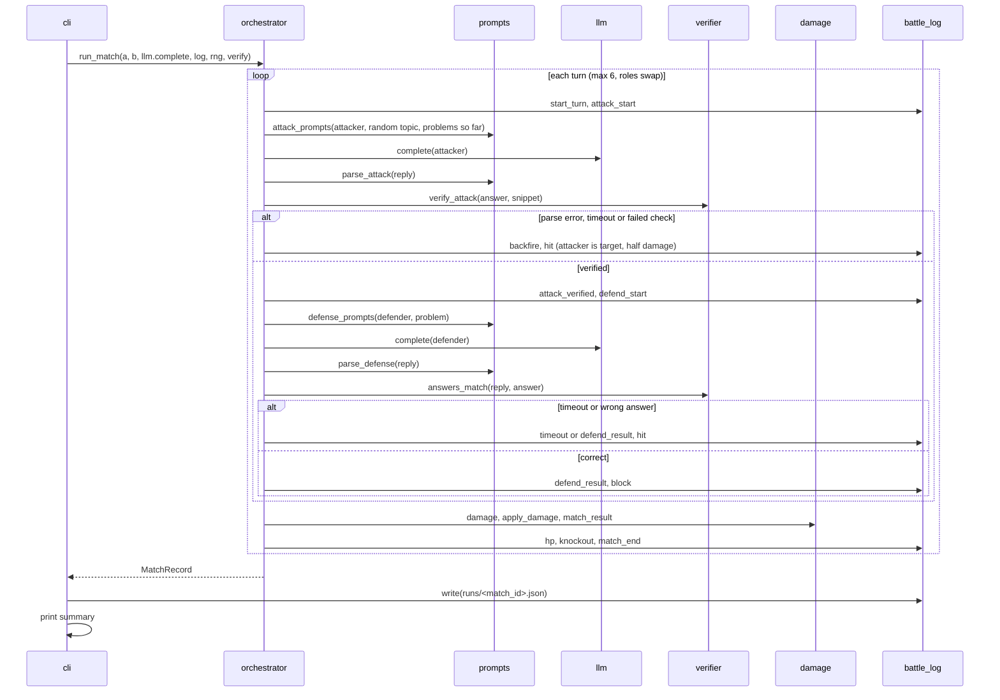

# Flow

`arena sim --n N` repeats the loop above for each missing match (pairs picked by a per-index
seeded RNG), calling `stats.append_record` after each one, then prints `format_stats` over all
saved records.

`arena synth` runs the same `run_match` with `SyntheticLlm.complete` and `synthetic_verify`
(scripted fighters, no network) for each cell of a skill x attacker-bonus table.

## Modules

- `models`: dataclasses (`Fighter`, `Attack`, `TurnResult`, `MatchRecord`, `MatchResult`).
- `damage`: pure rule functions and the Phase 0 constants (HP, base damage, max turns).
- `verifier`: SymPy answer equality and the snippet runner (subprocess, timeout, temp dir).
- `battle_log`: per-turn event list with `t` in ms, JSON writer.
- `config`: loads `config/fighters.toml` into settings, providers and fighters.
- `llm`: OpenAI-compatible client per provider, 429 backoff, delay between calls.
- `prompts`: attacker and defender prompts and tag parsing of the replies.
- `cli`: `arena match` and `arena sim` (load `.env` and config, run matches, print output).
- `stats`: balance stats over `MatchRecord`s, plus reading and appending the results JSONL.
- `synthetic`: scripted fighters and the balance sweep behind `arena synth` (D-020).
- `orchestrator`: `play_turn` and `run_match`, the only module that sequences a match.
