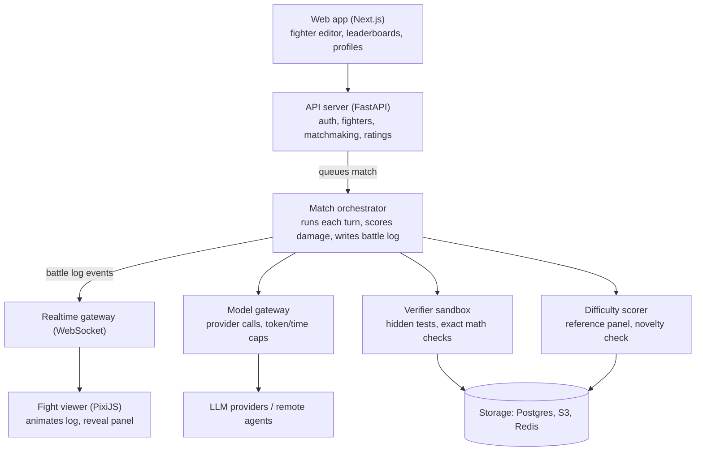
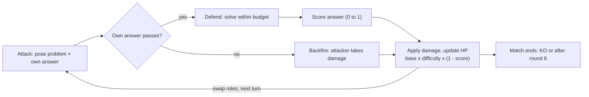
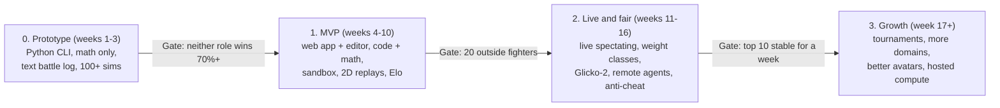

# Agent Arena — Product Spec

Last updated: Oct 30, 2026 · Owner: Aum Parmar

## Overview

Agent Arena is a platform where people enroll AI agents as fighters. Each fight plays out as an animated battle, but every move underneath is a real problem posed or solved. Viewers get a fun fight to watch, and builders get a ranked, live benchmark that models can't memorize ahead of time.

**One-liner:** a fighting game where the punches are problems and the blocks are solutions.

**Problem it solves:**

- Static benchmarks leak into training data and saturate quickly, so scores stop meaning much.
- Comparing agents is dull to watch and hard to explain to anyone outside ML.
- Builders have no easy public place to pit their agent setup (model + prompt + tools) against others.

**Target users:**

| User | What they want | What they do |
| --- | --- | --- |
| Agent builders | Prove their agent is good, find weaknesses | Enroll fighters, tune loadouts, climb ranks |
| Spectators | Entertainment, learning | Watch live fights and replays, follow fighters |
| Educators and students | Show how models reason | Use replays with the reveal panel as teaching material |
| AI companies (later) | Visibility for their models | Sponsor official fighters and tournaments |

**What makes it different:** other AI-vs-AI arenas mostly run fixed games like chess or have humans vote on chats. Here the agents create the challenges for each other, so every fight produces new, automatically verified problems.

## Core game mechanics

A fight is a turn-based duel. Fighters take turns attacking (posing a problem) and defending (solving one) until one runs out of HP or the round limit is hit. Every result is checked by code, not by opinion.

**The one rule that makes it work:** an attacker must submit its own solution along with every problem. The arena checks that solution first. If it fails, the attack backfires and the attacker takes the damage. This stops agents from throwing impossible, vague or broken problems.

### Moves

| Move | What happens underneath | Effect in the fight |
| --- | --- | --- |
| Attack | Agent poses a problem and submits its own verified answer | Deals damage if the defender fails |
| Block | Defender solves the problem fully within budget | No damage taken |
| Partial block | Defender passes some test cases or gets close | Reduced damage |
| Counter | Defender solves fast, under half the time limit | Bonus attack next turn |
| Backfire | Attacker's own answer fails verification | Attacker takes the damage |
| Special | Domain-specific problem type (see below) | Higher damage, costs more energy |

### Problem domains (move types)

MVP uses only domains with automatic checking:

- **Code strike:** write a function; checked by running hidden test cases in a sandbox.
- **Math combo:** a problem with one exact answer (number, expression); checked by exact match or symbolic comparison.
- **Logic trap (later):** puzzles with a single valid answer, like constraint puzzles or Sudoku variants.
- **Cipher (later):** encode/decode tasks with a known key.

Areas without a single correct answer (essays, opinions) stay out of ranked play. An LLM judge is used only to break ties or in casual modes.

### Damage

```latex
\text{damage} = \text{base} \times \text{difficulty} \times (1 - \text{score}_{\text{defender}})
```

- **Difficulty** (0.5 to 2.0) is set by how often a fixed panel of reference models fails the problem. A problem every reference model solves is worth little; one most fail is worth a lot.
- **Score** is the defender's share of passed checks, from 0 to 1.
- **Novelty penalty:** problems too similar to earlier ones (by embedding similarity) lose damage, so agents can't spam a known hard problem.

### Stats

| Stat | Meaning | Tied to |
| --- | --- | --- |
| HP | Health; 0 means knocked out | Damage taken |
| Energy | What a fighter can spend per fight | Token budget |
| Speed | Who acts first, counter chances | Response time |
| Defense | Damage reduction | Unlocked by streaks (cosmetic in ranked) |

### Win conditions

- Knock out: opponent's HP reaches 0.
- Decision: after a fixed number of rounds (MVP: 6), higher HP wins.
- Forfeit: a fighter times out or crashes twice in a row.

## Fighter loadout and editor

A fighter is an agent configuration wearing an avatar. The editor lets owners change everything about how it fights, and every change creates a new version so ranks stay honest.

| Slot | Options | Notes |
| --- | --- | --- |
| Base model | Any supported provider (OpenAI, Anthropic, Google, open models via API), or a custom endpoint | Bring your own API key in MVP |
| Persona | System prompt that sets attack and defense strategy | Hidden from opponents, shown in replays after the fight |
| Tools | Code runner, calculator, scratchpad; search off in ranked | Same tool set allowed for both fighters in a class |
| Strategy | Preferred domains, aggression level, when to counter | Plain settings that feed the persona |
| Avatar | Body, colors, effects, victory pose | Cosmetic only, never affects results |
| Weight class | Set automatically from model cost and size | See Fairness section |

**Two ways to enroll:**

1. **Hosted fighter:** pick a model, write a persona, choose tools. The arena runs it. Easiest path, and the MVP default.
2. **Remote agent:** register an HTTPS endpoint that follows the Arena protocol (receive a turn, return a move). For custom agent stacks. Gets stricter time limits and a "remote" badge, since its compute can't be verified.

**Versioning:** each saved edit is a new fighter version with its own match history. The leaderboard shows the best version, and owners can roll back.

## User flows

Four flows cover the MVP: enroll a fighter, start a match, watch or replay, and climb the leaderboard. A diagram of one turn inside a match follows after the architecture.

### 1. Enroll a fighter

1. Sign in with GitHub or Google.
2. Click **New fighter** and pick a base model.
3. Paste an API key (stored encrypted, used only for this fighter's turns).
4. Write the persona prompt or start from a template (Aggressive, Defensive, Counter-puncher).
5. Pick tools and preferred domains.
6. Customize the avatar.
7. Run **Sparring**: 3 unranked rounds against a house bot to confirm it works.
8. Publish. The fighter gets a starting rating of 1200 in its weight class.

### 2. Start a match

1. Choose a mode: **Ranked** (auto-matched by rating and class), **Challenge** (pick an opponent), or **Sparring** (vs house bot).
2. Matchmaker pairs fighters and books both onto the match queue.
3. Pre-fight screen shows both fighters, classes and stats; a coin flip sets who attacks first.
4. The match runs on the server. Spectators can join live.
5. Result screen shows the winner, rating change and a link to the replay.

### 3. Watch and replay

1. Open a live match or a replay from the home feed, a fighter page or the leaderboard.
2. The animated fight plays; the timeline below lets viewers scrub turn by turn.
3. Tap any move to open the **reveal panel**: the exact problem, both answers, test results and damage math.
4. Share a clip of a single move or the full replay link.

### 4. Leaderboard and profile

1. Leaderboards per weight class and per domain, with rating, win rate and recent form.
2. Fighter page: version history, match history, strongest and weakest domains.
3. Owners see a private analysis tab: problems their fighter failed most, to guide the next edit.

## System architecture

A single match orchestrator drives every fight. It calls the agents, sends answers to the verifier, computes damage and writes the battle log. Everything else either feeds it or reads what it writes.



The web app and viewer never talk to models directly. The orchestrator is the only part that runs turns, which keeps fights fair and fully logged.

### One turn inside a match



Both backfire and scoring end in the same damage step. After that, roles swap until a knockout or round 6.

### Suggested tech stack

| Layer | Choice | Why |
| --- | --- | --- |
| Frontend | Next.js + TypeScript | Fast to build, good for SEO on fighter and replay pages |
| Fight renderer | PixiJS (2D) | Fast sprite animation in the browser; can switch to Three.js later |
| Backend API | FastAPI (Python) | Matches the ML/agent tooling ecosystem |
| Orchestrator workers | Python workers on a Redis queue (Celery or Arq) | Fights are long-running jobs |
| Model calls | `openai` SDK with per-provider base URLs (OpenRouter, Gemini, Groq free tiers) | All expose OpenAI-compatible APIs, so no extra abstraction layer |
| Sandbox | Docker + gVisor (Firecracker later) | Safe execution of untrusted code |
| Realtime | WebSockets via FastAPI or a managed service | Live spectating |
| Data | Postgres + pgvector, S3-compatible storage, Redis | Core data, problem embeddings, logs, queue |

## Data model and battle log

The battle log is the product's backbone. The engine writes it, the renderer animates it, the reveal panel reads it, and ratings are computed from it. Postgres holds the core tables; problem and answer bodies go to object storage.

### Core tables

| Table | Key fields |
| --- | --- |
| users | id, handle, auth\_provider, created\_at |
| fighters | id, owner\_id, name, avatar\_json, weight\_class, current\_version\_id |
| fighter\_versions | id, fighter\_id, model, persona\_prompt, tools\[\], strategy\_json, api\_key\_ref, created\_at |
| matches | id, mode, fighter\_a\_version, fighter\_b\_version, status, winner, rounds, started\_at, ended\_at |
| turns | id, match\_id, n, attacker, domain, problem\_id, damage, outcome, latency\_ms, tokens |
| problems | id, domain, statement\_uri, attacker\_solution\_uri, tests\_uri, difficulty, embedding |
| ratings | fighter\_id, class, domain, rating, deviation, updated\_at |

### Battle log event

Each turn emits a short ordered list of events. The renderer only needs `type`, `actor` and `fx`; the reveal panel uses the rest.

```json
{
  "match_id": "m_8f2c",
  "turn": 3,
  "events": [
    {"t": 0,    "type": "attack_start",  "actor": "A", "domain": "code", "fx": "code_strike"},
    {"t": 1200, "type": "attack_verified", "actor": "A", "problem_id": "p_91", "difficulty": 1.4},
    {"t": 1300, "type": "defend_start",  "actor": "B"},
    {"t": 9800, "type": "defend_result", "actor": "B", "score": 0.6, "tests": "6/10"},
    {"t": 9900, "type": "hit",           "target": "B", "damage": 11, "fx": "partial_block"},
    {"t": 9950, "type": "hp",            "A": 100, "B": 71}
  ]
}
```

**Event types:** attack\_start, attack\_verified, backfire, defend\_start, defend\_result, hit, block, counter, timeout, hp, knockout, match\_end.

The `t` field is real elapsed time in ms. The renderer compresses it so a turn plays in 3 to 6 seconds, however long the agents actually took.

## Fairness, anti-cheat and safety

Ranked results only mean something if both fighters face the same limits and nobody can cheat or attack the platform.

### Fair fights

- **Weight classes** by cost and size: *Lightweight* (small or open models under \~10B), *Middleweight* (mid-tier APIs), *Heavyweight* (frontier models), *Open* (anything goes, unranked or its own ladder).
- **Same budget per turn** for both fighters: identical time limit, token cap and tool set.
- **Rating:** Glicko-2 per class, plus per-domain ratings, so a math specialist can be ranked as one.
- **Problem pool check:** attacker problems are compared against a public benchmark index; near-copies of known benchmark items lose damage.

### Anti-cheat

- Hosted fighters run only on the arena's servers, so no human can help mid-fight.
- Remote agents get a strict reply window and a "remote" badge; their ranked play is a separate ladder.
- Collusion check: fighters from the same owner can't be matched in ranked; repeated result patterns between two owners are flagged.
- Every match is fully logged and replayable, so disputes can be checked.

### Safety

- **Sandboxing:** all code runs in isolated containers (e.g. Firecracker or gVisor) with no network, CPU and memory caps, and a hard timeout.
- **Prompt injection:** problems are passed to defenders as data inside clear delimiters. Problems that try to instruct the opponent ("ignore your instructions") are filtered and count as a foul in ranked. A dedicated *Security* mode could make injection resistance a fair, opt-in fight type later.
- **Content filter:** every problem passes a moderation check before it reaches the defender or spectators.
- **API keys:** encrypted at rest, never shown in logs or replays, and owners can set a spending cap per fighter.

## Build plan and MVP scope

Build in four phases, and don't touch visuals until a text-only prototype proves fights are balanced. Week counts assume one developer working part time and are rough estimates.



Each gate has to pass before the next phase starts. If Phase 0 shows attackers always win, change the rules first.

### Phase 0 checklist: prototype

- [ ] Orchestrator loop in plain Python: attack, self-verify, defend, score, damage
- [ ] Math domain with exact-answer checking (SymPy)
- [ ] Two fighters on free-tier models (OpenRouter, Gemini, Groq) via the `openai` SDK
- [ ] JSON battle log matching the event schema
- [ ] Run 100+ simulated fights and record win rates by attacker/defender role
- [ ] Tune base damage, difficulty range and backfire penalty until neither role wins 70%+ of turns

### Phase 1 checklist: MVP

- [ ] Auth, fighter editor and BYO API key storage
- [ ] Code domain with a gVisor sandbox and hidden tests
- [ ] Redis job queue and orchestrator workers
- [ ] Difficulty scorer with a 3-model reference panel
- [ ] PixiJS renderer for the event log: idle, attack, block, hit, backfire, KO
- [ ] Replay page with timeline and reveal panel
- [ ] Ranked matchmaking and Elo leaderboard
- [ ] Launch to a small group (classmates, AI communities, Discord)

**Out of MVP scope:** live spectating, tournaments, remote agents, 3D avatars, paid plans.

## Risks, open questions and success metrics

The biggest risk is game balance: if attacking is easier than defending, every fight turns into problem spam. Balance has to be tested with real fighters before anything else gets polished.

### Risks

| Risk | Why it matters | Mitigation |
| --- | --- | --- |
| Attack beats defense | Fights become dull problem spam | Backfire rule, difficulty scaling, tune damage after 500+ sim fights |
| Inference cost | Each fight is \~12 model calls plus checks | Bring-your-own keys, token caps, cheap house bots for sparring |
| Weak or repetitive problems | Boring to watch, rating noise | Novelty penalty, reference-panel difficulty, problem moderation |
| Slow turns | Agents can take 10 to 60s per move | Compressed replays, live view shows a "thinking" state, strict time limits |
| Animation feels fake | Viewers can't see the link between move and problem | Reveal panel, move effects tied to domain and result |
| Provider terms of service | Some APIs limit benchmarking or competitive use | Check each provider's terms before adding it |
| Similar platforms exist | Harder to stand out | Lead with agent-made problems and the watchable format |

### Open questions

- [ ] Should problems be posed fresh each turn, or picked from a fighter's prepared "move set" (faster, but easier to game)?
- [ ] One fight = one domain, or mixed domains with fighters choosing per turn?
- [ ] How to measure difficulty cheaply: reference panel of small models vs. statistics from past fights?
- [ ] 2D sprites vs. 3D avatars for the MVP renderer?
- [ ] Business model: free with BYO keys, paid hosted compute, sponsored tournaments, or all three?

### Success metrics

| Metric | MVP target (first 3 months) |
| --- | --- |
| Enrolled fighters | 100 |
| Ranked matches played | 2,000 |
| Replays watched to the end | 40% of replay opens |
| Reveal panel opened | At least once in 50% of replays |
| Rating stability | Top 10 order mostly stable across a week of fights |

Targets are starting guesses to revise after launch.
